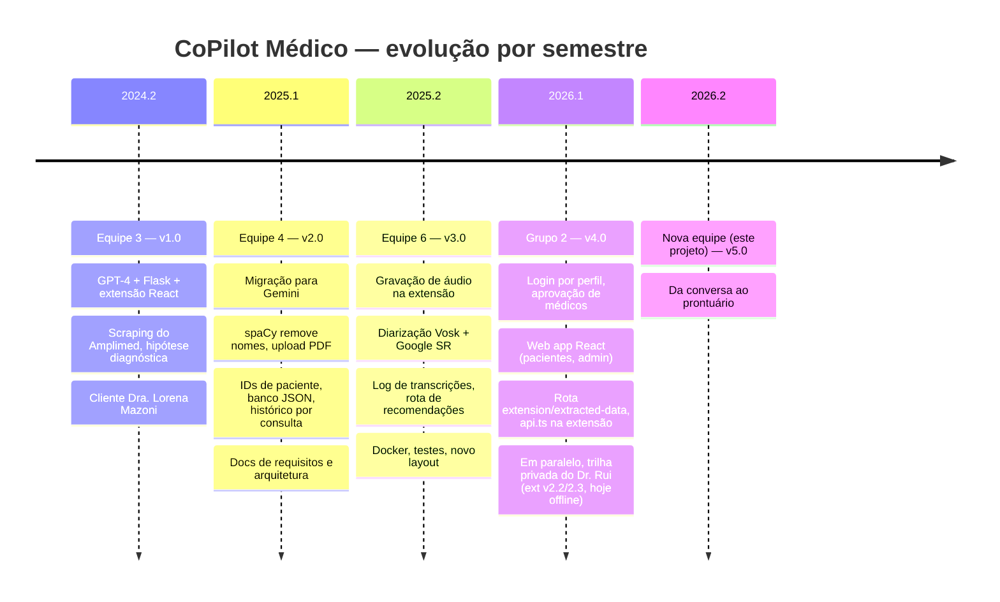

# 01 — Histórico dos quatro ciclos

Este documento reconstrói o que cada equipe fez, extraído dos seis vídeos (pitch + relatório técnico das Equipes 3, 4 e 6), do histórico git de três repositórios e da documentação em PDF do Grupo 2 (anexo C). A leitura deste arquivo é a primeira tarefa da Sprint 0.

## Linha do tempo

---

## Ciclo 1 — Equipe 3 (2024.2) — v1.0 "Prova de conceito"

**Fontes:** vídeos `EQUIPE 3 - COPILOT MEDICO - PITCH` e `EQUIPE 3 - COPILOT MEDICO - RELATÓRIO TÉCNICO`; primeiro commit do repositório da Equipe 4 (`1st' Commit`, 27/04/2025), que herdou o código da v1.

**Problema apresentado no pitch:** demora no atendimento e desatenção do profissional, lidas pelo paciente como desleixo quando na verdade são **sobrecarga cognitiva**. Objetivo: atender mais pacientes em menos tempo com apoio à decisão clínica.

**O que foi construído:**
- Extensão Chrome (Manifest V3) em TypeScript + React + Vite, popup com chat.
- Content script faz *web scraping* da página do prontuário Amplimed: campos `input[f_prontuario="peso|altura|imc|tempe|freqres|freqcar|pas|pad"]` e as notas editáveis `.note-editable[role="textbox"]` (anamnese, exame físico, conclusão diagnóstica, lista de problemas).
- Backend Flask (`server.py`, uma rota `/api/extracted-data`) que concatena os campos e envia ao **GPT‑4** via `openai_connection.py`, com um *system prompt* (`Co-Pilot_medico.txt`) que pede até três hipóteses diagnósticas com percentual e referências.
- Chave da API guardada em arquivo de texto no repositório (`api-key.txt`) — removida depois pela Equipe 4.

**Demo do pitch:** paciente simulado com manchas vermelhas, fadiga, corpo mole; a ferramenta devolve **dengue** como principal hipótese, com zika como diferencial. O apresentador reforça duas vezes que "o médico precisa sempre validar".

**Depoimento:** Dra. Lorena Mazoni (cliente final) — "quando o Rui trouxe a ideia na fase embrionária ela ficou encantada" e destacou agilidade, apoio à decisão e redução de sobrecarga.

**Justificativas técnicas no relatório:** Python pela facilidade de tratar linguagem natural; TypeScript + extensão Chrome pela coleta dinâmica de dados antes da requisição; branches por feature e merge na `main`.

**O que ficou para os próximos:** integração fixa com GPT‑4, sem anonimização, sem persistência, sem testes.

---

## Ciclo 2 — Equipe 4 (2025.1) — v2.0 "Privacidade e memória"

**Fontes:** repositório `J-Eduardo25/copilot_medico_G4_2025.1` (59 commits, 27/04 → 17/08/2025, 9 contribuidores), vídeos `Equipe 4 - Copilot Médico - Pitch` e `Relatório Técnico`, `documents/Requisitos.md` (14/06/2025) e `documents/Documento de arquitetura.pdf` (12 páginas).

**Contribuidores (por commits):** AdelmoABNeto (29), João Eduardo M. de Freitas (10), Nielso Júnior (6), jonatasalex (6), João Batista de Aguiar Júnior (6), Gaiutuz (1), fabiodof (1).

**Cronologia git relevante:**
- 27/04 — herda v1 (OpenAI).
- 29/04 — Nielso inclui escopo da versão 2.0 no README.
- 05/05 — Adelmo **migra para Gemini** e apaga a integração OpenAI; Jônatas adiciona **upload de PDF** (PyPDF2).
- 12/05 — Jônatas: **filtragem do nome do paciente** (spaCy `pt_core_news_lg`, entidades `PER`).
- 14/05 — workflow GitHub Actions para buildar a extensão.
- 26/05 — atualização de prompt e "função de processamento de áudio" (protótipo `audio_listener.py` com sounddevice + Vosk, nunca ligado ao servidor).
- 03/06 — **IDs de paciente e banco JSON** (`patient_db.py`, `patients_db.json`).
- 09/06 — persistência do histórico ao fechar a extensão; **botão externo flutuante**.
- 14–16/06 — documento de requisitos (US001–US010), documento de arquitetura, otimização de prompt, "upgrade de API", fix da filtragem de dados do Amplimed.
- 01–05/07 — consultar ID de paciente, recuperar atendimentos, **dropdown de histórico** de pacientes e consultas.

**Entregas descritas no relatório técnico:** React + TS + Vite; content scripts e service worker comunicando via `fetch`; `chrome.storage.local` guarda ID do paciente e histórico; Flask anonimiza com spaCy e envia ao Gemini; PyPDF2 extrai exames; banco JSON por paciente; GitHub com branches de dev/teste/produção; **Trello** por sprints.

**Pitch:** "Menos tempo com burocracia, mais tempo com o que realmente importa." Anuncia o sistema de IDs para "histórico contínuo e anônimo" e protótipos de áudio "em teste".

**Requisitos formalizados (Requisitos.md):**
- Implementados: US001 chat no navegador, US002 perguntas livres, US003 texto adicional, US004 upload de PDF, US005 captura do Amplimed com botão flutuante, US006 proteção LGPD, US007 histórico por paciente com ID.
- Identificados, não implementados: US008 áudio da consulta.
- Sugeridos ao cliente: US009 histórico pesquisável, US009 (numeração duplicada) integração com outros prontuários, US010 exportar resumo em PDF/TXT.

**Arquitetura documentada:** três camadas (apresentação React, aplicação Flask, dados JSON); diagrama de fluxo; caso de uso; tecnologias.

**O que ficou:** a rota `/api/extracted-data` da v1 **não foi recriada** quando o servidor foi reescrito para o Gemini — a extensão continua chamando-a (ver diagnóstico D‑01). Anonimização cobre só nomes de pessoa.

---

## Ciclo 3 — Equipe 6 (2025.2) — v3.0 "Ouvir a consulta"

**Fontes:** repositório `Jamuelton/copilot_medico_grupo_6_es` branch `develop` (125 commits acumulados, 06/10 → 01/12/2025, 8 novos contribuidores), vídeos `Equipe 6 - Copilot Medico - Pitch` e `Relatório Tecnico`, diagramas em `documents/` (arquitetura em forma livre, diagrama de classes planejado e implementado da funcionalidade de áudio).

**Contribuidores novos (por commits):** Lucas Rafael Leite (24), Ana Laura (13), Jamuelton (14), GabriPoli (7), Francisco Marcelo de Barros Maciel (4), GabrielsLeal04 (4).

**Cronologia git relevante:**
- 06/10 — README ganha seção "Funcionalidades".
- 17–21/10 — modelo Gemini válido (`gemini-flash-latest`), Docker (API + front), CSS com `@media`.
- 25–31/10 — novo layout, tema claro/escuro, **suíte de testes unitários** (Francisco) e **testes TDD das rotas** `/patients`, `/patient-exists`, `/all-patients` (GabriPoli); integração da captura de voz Google.
- 03/11 — Ana Laura: novo layout sem header, biblioteca de ícones.
- 06/11 — fix: enviar mensagens em consultas criadas por "Importar Consulta".
- 10/11 — botão flutuante **comentado** (desativado).
- 15–16/11 — rota `/api/recommendations` (Lucas), endpoint de diarização (GabriPoli), transcrição com Google (Francisco), tela de áudio e componentes, correções no front.
- 17–24/11 — primeira versão do áudio na extensão (Jamuelton), pausa da gravação (GabriPoli), histórico de transcrições v1 e v2, **diarização** (Lucas).
- 01/12 — organização final: requirements.txt, testes numa pasta única, diagramas, `MODO_TESTE_SOZINHO` "False por default" (no arquivo final ainda está `True`).

**Pipeline de áudio (relatório técnico):** a extensão grava com `MediaRecorder`, converte para **WAV** e envia `multipart/form-data` a `/api/transcribe_audio`. No servidor, a classe `Diarizador` usa **Vosk** (`vosk-model-small-pt-0.3` + `vosk-model-spk-0.4`) para segmentar falantes por vetor de voz, e a biblioteca `SpeechRecognition` com o reconhecedor **Google** (API gratuita, não oficial) para transcrever cada bloco; se falhar, usa o texto do Vosk. A "lógica ping‑pong" define o primeiro falante como Médico e o segundo como Paciente. O resultado vira `transcription_log` no JSON do paciente e alimenta o chat do Gemini.

**Rota de recomendações:** `/api/recommendations` envia o prompt de `recommendations.txt` ("analise o diálogo completo, ignore nomes, identifique padrão, risco, diagnóstico diferencial, exame ou pergunta que eu deveria considerar agora; frases curtas") sobre o histórico da consulta.

**Pitch:** narrativa centrada na escuta — "o ato de ficar digitando enquanto a pessoa fala pode quebrar a conexão"; fluxo em quatro passos (criar perfil, gravar, parar, ler transcrito); tela dividida transcrição bruta × análise da IA; impacto: mais foco no paciente, diagnóstico mais preciso, menos carga administrativa, prontuários mais completos.

**Outros artefatos:** `worker.py` (consumidor RabbitMQ de chunks de áudio — nunca integrado), `audio_listener.py` (microfone do servidor — protótipo), `config.py` com `pydantic-settings` (não usado pelo `server.py`), `docker-compose.yml` (backend na 3001, front em nginx na 8080 — o front em nginx não faz sentido para uma extensão).

---

## Ciclo 4 — Grupo 2 (2026.1) — v4.0 "Sistema gerenciador"

**Fontes:** repositório `qleticia/copilot_medico_grupo_2_es` (fork da base da Equipe 6; 24 commits entre 05/07 e 14/07/2026), `docs/anexos/C-documentacao-grupo-2-2026-1.pdf` (documentação entregue à disciplina, 12 páginas) e o README reescrito pelo grupo. Não foram localizados vídeos. Este ciclo **não constava** na versão de 15/09 deste documento; foi incorporado em 20/09/2026, quando o fork e a documentação chegaram ao PO.

**Equipe (7):** Aline Ferreira Barbosa, Italo Rangel, Aimê Carvalho Guimarães, Camila de Sá Vaz, Eryck Emmanuels, Lays Leticia, Leticia Rodrigues. No git: Leticia Rodrigues Quirino (backend de autenticação, rota da extensão, textos), Camila de Sá Vaz (endpoint `extension/extracted-data`), Eryck Emmanuels (base do web app), Aimê Guimarães (tela de pacientes com dados da extensão), Lays Leticia (envio da extensão ao backend), Italo Baracho (merges e README). Aline não aparece como autora de commits.

**Tese do ciclo (PDF, seção 1):** um **Sistema Gerenciador Web** passa a ser o núcleo da solução — login, pacientes, consultas, prontuário, exames, dashboard — e a extensão vira "módulo de apoio operacional durante a consulta". O fluxo descrito tem cinco etapas: início da consulta no gerenciador (cria `session_id` + `patient_id`) → extensão grava/chat/exames → envio ao backend Flask → anonimização → recuperação do contexto clínico.

**O que foi construído (delta real sobre a v3.0: 37 arquivos, +4.570/−362 linhas):**
- **Autenticação no backend** (`API/backend/auth_service.py`, 521 linhas; `auth_decorators.py`): usuários em `users_db.json` com senha em scrypt (Werkzeug); quatro perfis declarados (`administrador`, `medico`, `recepcao`, `usuario`), dois utilizáveis; JWT HS256 com 60 min; **fluxo de aprovação de médicos** (`register-doctor` → `pending` → admin aprova/rejeita). Todas as 10 rotas antigas passaram a exigir token e perfil; posse de paciente por `doctor_id`.
- **Rota `POST /api/extension/extracted-data`** (+ alias `/api/extracted-data`): recebe `patient_id`, `consultation_id`, `source_url` e o conteúdo raspado pela extensão; grava em `extension_data`; se houver consulta, envia ao Gemini. Fecha em parte a regressão D‑01.
- **Web app React/Vite** (`front/copmed-web`, JavaScript): Login com abas Entrar/Cadastrar médico, Dashboard, Pacientes (lista, cadastro, consultas, dados da extensão, áudios/transcrições), Admin de médicos (aprovar/rejeitar). Cinco de oito telas (Agenda, Consulta, Atendimentos, Histórico, Ajustes) são placeholders.
- **Extensão:** `src/services/api.ts` centraliza todas as chamadas (fim dos `fetch` espalhados e da URL fixa em `App.tsx`); tela de login na própria extensão; token em `chrome.storage.local`; `background.js` reescrito para enviar os dados extraídos com token.
- **Testes:** +283 linhas (3 casos em `test_patient_db.py`, 9 em `test_server_api.py`). **README** reescrito; `front/copmed-web/README.md` com "limitações conhecidas" honestas.

**Requisitos declarados como implementados (PDF, seção 5):** US01 login · US02 cadastrar paciente · US03 consultar pacientes · US04 iniciar consulta · US05 encerrar consulta · US06 visualizar prontuário · US07 recuperar histórico clínico · US08 armazenar informações clínicas · US09 consultar assistente · US10 gerar informações estruturadas · US11 upload de exames · US12 extrair informações de exames. (Numeração própria do grupo; não coincide com US001–US010 da Equipe 4 nem com US011–US024 deste plano.)

**O que ficou para os próximos (detalhado no doc 02, seção 0):** instalação padrão inacessível (sem `AUTH_BOOTSTRAP_*` não existe admin; sem `AUTH_SECRET_KEY` toda rota devolve 500); médico logado não vê os pacientes legados (`doctor_id` nulo); PyJWT fora do `requirements.txt` (roda um HS256 caseiro); 16 testes quebram por 401; CI não builda a web nem roda pytest; `App.tsx` cresceu para 1.972 linhas; conteúdo bruto da extensão gravado sem anonimização; nenhuma das 8 variáveis novas documentada; diarização, prompt, banco JSON, seed "João Silva" e modelos Vosk no git seguem como na v3.0.

**Lição do ciclo:** a equipe ampliou a superfície do produto (web app) e resolveu o problema de segurança mais grave da v3.0 (API sem autenticação), mas sem integrar a documentação (`Requisitos.md` intocado, requisitos em PDF à parte), sem CI e sem fechar o próprio fluxo de instalação. A v5.0 parte desta base — não da v3.0.

---

## Trilha paralela — extensão privada v2.2/v2.3 (abril/2026)

Não faz parte do histórico acadêmico, mas é a referência mais completa do que o cliente quer. Extensão em JavaScript puro (6.567 linhas em 6 arquivos, "Sprint S11"):

- Autenticação Google via `chrome.identity` → Supabase; login demo "Dr. Rui Pontes, CRM‑CE".
- Backend Next.js em `copilot-medico.vercel.app/api/*`: `auth`, `health`, `transcription` (Whisper large‑v3 via Groq), `soap`, `patients`, `prescribe`, `certificate`, `document`.
- Sidebar com 4 abas: Gravação (SOAP S/O/A/P + CID‑10 + transcrição), Pacientes (busca, cadastro, "Importar do PEP"), Receitas (IA), Documentos (atestado, declaração, laudo, encaminhamento).
- Detecção de 9 prontuários (Tasy, MV, SISS, e‑SUS PEC, iClinic, SHOSP, Amplimed, Doctoralia, Pixeon) com seletores CSS por sistema; **injeção do SOAP formatado** no campo de evolução de cada PEP; widget flutuante com auto‑gravação e detecção de silêncio; cache de 20 SOAPs, fila offline, badge.
- Estado em 15/09/2026: o deploy Vercel responde `402 DEPLOYMENT_DISABLED`; a extensão não funciona sem ele.

O que a v5.0 **absorve** dessa trilha: o conceito de SOAP estruturado com CID‑10, o padrão de adaptador por PEP com escrita de volta, e o fluxo "gravar → SOAP → inserir no prontuário". O que **não** absorve: Supabase/Vercel (stack diferente da acadêmica), receitas e atestados com IA (fora do escopo por responsabilidade legal), suporte a 9 PEPs (inviável em 4 meses).

---

## Padrões que atravessam os quatro ciclos

1. **Cada equipe recomeça a documentação.** O único documento de requisitos versionado é da Equipe 4; a Equipe 6 não o atualizou e o Grupo 2 entregou os seus em um PDF à parte (anexo C), deixando `Requisitos.md` intocado. A v5.0 deve manter `docs/` vivo dentro do repositório.
2. **Nada é medido.** Nenhum ciclo mediu qualidade da transcrição ou das hipóteses. A v5.0 introduz um conjunto de casos de referência.
3. **Testes chegam no fim e não rodam no CI.** A Equipe 6 escreveu 532 linhas de testes, mas o workflow só builda o front. O Grupo 2 acrescentou 283 linhas, mas 16 testes quebram por falta de token e o workflow continua o mesmo.
4. **O médico valida tudo** — dito em todos os pitches gravados. A v5.0 transforma isso em regra de produto: nenhuma saída da IA entra no prontuário sem o médico editar/aprovar.
5. **Privacidade é prometida, parcialmente entregue.** "Roda localmente e remove o nome" é verdade só para nomes de pessoa; CPF, telefone, endereço e datas passam. Na v4.0, o conteúdo bruto da extensão é gravado sem passar nem pelo filtro de nomes.
