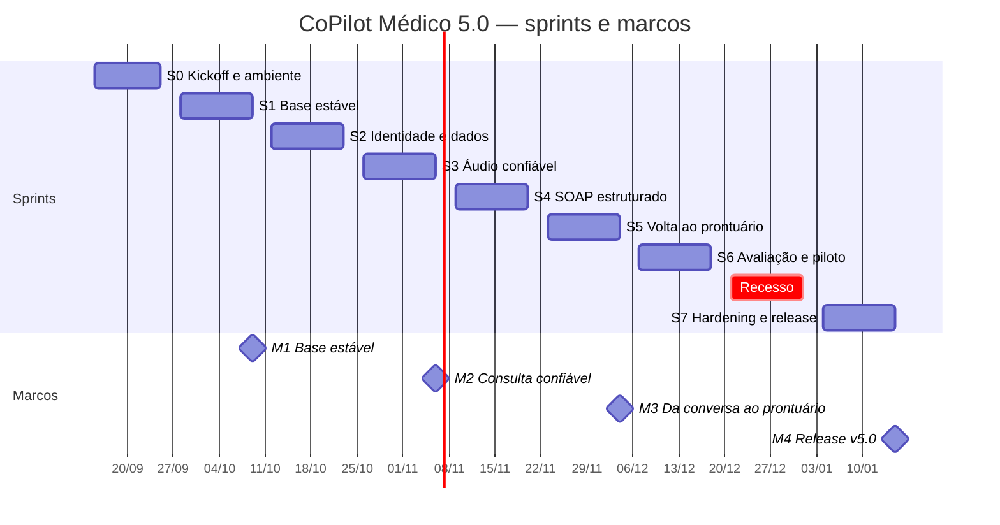

# 06 — Roadmap de 4 meses (15/09/2026 → 15/01/2027)

Oito sprints de duas semanas, com recesso de 21/12 a 03/01. Cada sprint termina em sexta‑feira com **review demonstrada ao PO** e retrospectiva. Os marcos M1–M4 são as datas em que o PO avalia formalmente o projeto.

## Calendário

| Mês | Período | Foco | Marco |
|---|---|---|---|
| 1 | 15/09 – 09/10 | Ler, consertar, estabilizar | M1 |
| 2 | 12/10 – 06/11 | Banco, login, LGPD, áudio pago | M2 |
| 3 | 09/11 – 04/12 | SOAP, CID‑10, adaptadores de PEP | M3 |
| 4 | 07/12 – 15/01 | Avaliar, pilotar, endurecer, entregar | M4 |

---

## Sprint 0 — Kickoff e ambiente (15/09 – 25/09, 9 dias úteis)

**Objetivo:** todo mundo com o projeto rodando e o backlog refinado.

- Leitura guiada dos docs 01–05; cada membro apresenta 5 min sobre uma parte do código legado.
- Criar organização + repositório único (ADR‑09); importar histórico da branch `develop`.
- Definir papéis (doc 07), quadro (GitHub Projects), convenções de branch/PR.
- Cada membro sobe backend + extensão localmente e registra no README o que faltou.
- ~~PO decide os itens pendentes do doc 10 (provedor de transcrição, segundo PEP).~~ Decidido em 15/09/2026: Gemini áudio e e‑SUS PEC. Restam P2, P4, P5, P7–P9.
- Refinar backlog das Sprints 1–2 (estimativas em pontos).

**Saída:** repositório único com CI (ainda só build), quadro com S1–S2 estimadas, README verificado.

## Sprint 1 — Base estável (28/09 – 09/10) → **M1**

**Objetivo:** o que existia volta a funcionar de ponta a ponta e é testado.

- US011: rota `pep-import`; unificar seletores do Amplimed; fixture HTML; teste.
- US012: CI com `pytest --cov`, `ruff`, `eslint`, `tsc`, `vite build`; branch protection.
- US013: `docker compose` com backend + Postgres (banco ainda não usado); `download_models.py`; `.env.example`; remover modelos Vosk do git (D‑19).
- Remover código morto (D‑08), seed "João Silva" (D‑09), documentar Python ≤ 3.12 (D‑05).
- Consertar testes existentes (D‑17) e adicionar testes de contrato para todas as rotas atuais.
- Quebrar `App.tsx` em `features/` (D‑18) — sem mudar comportamento.

**Demo M1:** extrair dados do Amplimed (página de exemplo), conversar, subir PDF, gravar áudio; CI verde; `docker compose up`.

## Sprint 2 — Identidade e dados (12/10 – 23/10)

**Objetivo:** multiusuário com dados protegidos.

- US015: modelos SQLAlchemy + Alembic; migrar `patients_db.json`; trocar `patient_db.py` por repositórios.
- US014: registro/login/refresh; middleware JWT; CORS restrito; testes de isolamento entre médicos.
- US016 (parte 1): `anonymizer/regex.py` (CPF, RG, CNS, telefone, e‑mail, CEP, datas) + NER; tokens estáveis; tabela `pseudonimo` cifrada.
- Front: tela de login; token em `chrome.storage.session`; client de API com renovação.

**Demo:** dois médicos com pacientes separados; payload enviado ao Gemini exibido lado a lado com o texto original (mostrando tokens).

## Sprint 3 — Áudio confiável (26/10 – 06/11) → **M2**

**Objetivo:** gravar com consentimento e transcrever com qualidade previsível.

- US017: tela de consentimento; gravação com pausa/retomar; chunks de 5 min; `TranscriptionProvider` com Gemini áudio (padrão), Whisper/Groq, Vosk (fallback); papéis por turno editáveis; remover `MODO_TESTE_SOZINHO` (D‑03); apagar áudio pós‑transcrição.
- US016 (parte 2): anonimizar turnos; log de auditoria de envios externos; teste de vazamento com 20 casos (parte textual).
- US022 (início): gravar os 10 áudios de referência com gabarito.
- US020: recomendações sobre janela parcial.

**Demo M2:** consulta simulada de 5 min gravada, transcrita com papéis, recomendações ao vivo; login; banco relacional.

## Sprint 4 — SOAP estruturado (09/11 – 20/11)

**Objetivo:** o coração da v5.0.

- US018: `SoapV1` (pydantic) + prompt PT‑BR versionado + `response_schema`; tabela CID‑10 embarcada com busca; `SoapEditor` na extensão (4 seções, CID‑10, alertas, pendências); versões IA × médico com diff; botão "Aprovar".
- Migrar `gemini_connection.py` para `services/llm/gemini.py` com `google-genai` (D‑06); prompts em PT‑BR sem referências (D‑07).
- US022: 20 casos sintéticos escritos e revisados pelo PO; `run_eval.py` v1 (completude, JSON válido, latência, custo).

**Demo:** consulta → SOAP → edição → aprovação; relatório de eval nos 20 casos.

## Sprint 5 — Volta ao prontuário (23/11 – 04/12) → **M3**

**Objetivo:** fechar o ciclo no prontuário eletrônico.

- US019: interface `PepAdapter`; `AmplimedAdapter` (leitura já feita + `writeEvolution`); `EsusPecAdapter` (leitura de cabeçalho + escrita no campo SOAP do PEC); `host_permissions` específicos (D‑15); botão flutuante só em PEP detectado (D‑02); `formatSoapForPep`.
- US021: export PDF/Markdown.
- Fixtures HTML dos dois PEPs e testes de adaptador (Vitest + jsdom).
- Ambiente de teste do e‑SUS PEC (Docker oficial do Ministério da Saúde) documentado.

**Demo M3:** fluxo completo em página real do Amplimed (conta de teste) e no PEC local: gravar → SOAP → aprovar → inserir no prontuário.

## Sprint 6 — Avaliação e piloto (07/12 – 18/12)

**Objetivo:** provar com números e com médicos.

- US022: `run_eval.py` completo (WER nos 10 áudios, acerto CID‑10, completude, custo); relatório versionado.
- US023: piloto com ≥ 2 médicos × 10 consultas simuladas; SUS + entrevistas; consolidar achados.
- Correções de usabilidade prioritárias do piloto.
- Teste de vazamento de PII completo (áudio + texto + PDF).
- Congelar escopo: nada novo entra depois de 18/12.

**Demo:** relatório de avaliação + vídeo curto do piloto.

## Recesso (21/12 – 01/01)

Sem entregas. Quem quiser adianta docs.

## Sprint 7 — Hardening e release (04/01 – 15/01) → **M4**

**Objetivo:** entregar limpo.

- Bugs do piloto; cobertura ≥ 60 %; revisão de segurança (checklist doc 08).
- US024: docs atualizados (requisitos, arquitetura, ADRs, changelog); vídeo pitch e relatório técnico; release `v5.0.0` com `dist.zip`; README de handoff para a próxima equipe.
- Retrospectiva final e lista "próximo ciclo" (doc 10).

**Demo M4:** apresentação final ao PO e à disciplina.

---

## Definição de pronto (DoD) — vale para todo item

1. Código em PR revisado por pelo menos um colega, CI verde.
2. Teste automatizado cobrindo o critério de aceite (backend: pytest; front: Vitest quando houver lógica).
3. Sem PII nova em logs, fixtures ou testes (checklist do PR).
4. Documentação tocada quando o item muda contrato de API, modelo de dados ou fluxo do usuário.
5. Demonstrado na review da sprint.

## Capacidade e estimativa

- Equipe de 6–8 alunos com ~8 h/semana cada → 100–130 h por sprint.
- Estimativa em pontos (1, 2, 3, 5, 8); 1 ponto ≈ 2 h. Backlog inicial: 66 itens, 256 pontos, distribuídos em `backlog/backlog-v5.csv` (S0 16 · S1 40 · S2 37 · S3 38 · S4 41 · S5 37 · S6 24 · S7 23).
- Reserva de 20 % por sprint para bugs e imprevistos; a Sprint 7 é 100 % reserva + entrega.

## Regras de mudança de escopo

- Item novo só entra trocando outro de mesmo tamanho, com aval do PO.
- Se M2 atrasar mais de uma sprint, o e‑SUS PEC sai do escopo (fica só Amplimed) — decisão automática, sem reunião.
- Se M3 atrasar, o export PDF sai e o piloto reduz para 1 médico.
