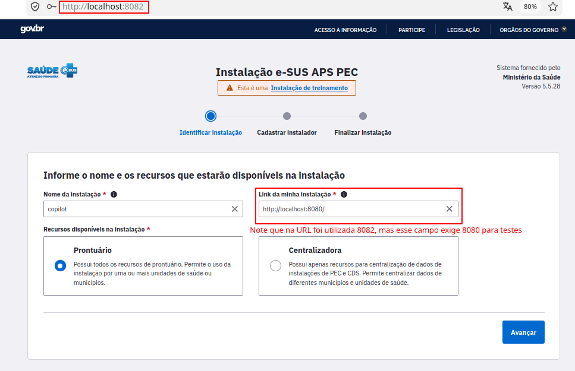
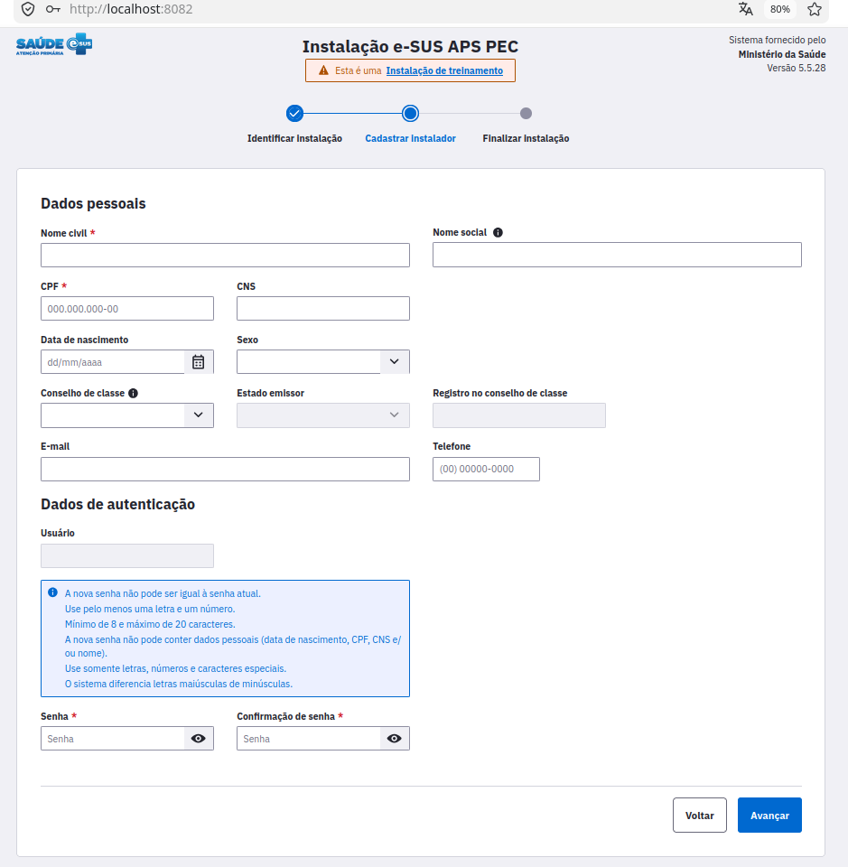

# 11 — e-SUS PEC local

Imagem Docker do **e-SUS AB PEC 5.5.28** (ambiente de treinamento), com o
PostgreSQL 9.6 embutido e o app rodando no mesmo container.

## Versão do PEC

| Item | Versão |
|---|---|
| e-SUS AB PEC | **5.5.28** (instalado em modo `-treinamento`) |
| Instalador | `eSUS-AB-PEC-5.5.28-Linux64.jar` (oficial) |
| JRE do app | 17.0.13 (embutido pelo instalador em `/opt/e-SUS/jre`) |
| JDK do build | 8 (só no estágio de instalação; o migrador do instalador não roda em JDK 16+) |
| PostgreSQL | 9.6.13 (embutido pelo instalador) |
| SO da imagem | Ubuntu 22.04 (jammy) |

## Instalação

### Pré-requisitos

- Docker 20.10+ (com BuildKit, padrão nas versões atuais)
- Linux x86_64 (ou Docker Desktop no Windows/macOS com backend x86_64)
- **~2,5 GB de RAM livres para o Docker**: a imagem roda o app com
  `-Xms256M -Xmx1024M` (veja [Memória](#memória))
- ~3 GB de disco para a imagem (~6 GB durante o build)

### Build da imagem

O build roda o instalador oficial do PEC dentro de um estágio temporário e
copia só o resultado (`/opt/e-SUS`) para a imagem final.

1. Clone o repositório:

   ```bash
   git clone https://github.com/ruypontes/copilot-medico.git
   cd copilot-medico/esus-pec
   ```

2. Baixe o instalador `eSUS-AB-PEC-5.5.28-Linux64.jar` no site oficial do
   e-SUS APS e coloque no diretorio esus-pec (ele não está no repositório:
   `*.jar` está no `.gitignore`). O nome precisa ser exatamente esse, pois o
   `Dockerfile` copia esse arquivo:

   ```bash
   ls -lh eSUS-AB-PEC-5.5.28-Linux64.jar   # ~744 MB
   ```

3. Faça o build (leva alguns minutos):

   ```bash
   docker build -t esus-pec:5.5.28 .
   ```

   O `Dockerfile` usa BuildKit (`RUN --mount=type=cache`). Em versões antigas
   do Docker em que ele não é o padrão, habilite com:

   ```bash
   DOCKER_BUILDKIT=1 docker build -t esus-pec:5.5.28 .
   ```

   Para salvar o log completo do build (útil para reportar erros):

   ```bash
   docker build --progress=plain -t esus-pec:5.5.28 . 2>&1 | tee build.log
   ```

4. Confira a imagem gerada (~3 GB) e suba o container (seção abaixo):

   ```bash
   docker images esus-pec
   ```

### Subindo o container

**Com o `docker-compose.yml` da raiz (recomendado).** O serviço `esus-pec`
fica no profile `esus`, então não sobe no `docker compose up` padrão (que não
exige o `.jar` nem 2,5 GB de RAM de quem não usa o PEC). Na raiz do projeto:

```bash
docker compose --profile esus up -d esus-pec          # faz o build se a imagem não existir
docker compose --profile esus up -d --build esus-pec  # força rebuild
```

O banco fica no volume `esus-pec-data`: sobrevive a `docker compose down` e
a rebuilds da imagem.

**Com `docker run`** (sem volume: o banco vive só dentro do container):

```bash
docker run -d --name esus -p 8081:8080 esus-pec:5.5.28
```

### Acessando

O app leva cerca de 1 minuto para subir. Acompanhe com:

```bash
docker logs -f esus
```

Depois acesse http://localhost:8081.

A porta 8080 do host fica com o `frontend` do `docker-compose.yml`, por isso
o PEC usa a 8081 (a porta interna do container continua 8080).

### Primeiro acesso: assistente de instalação

No primeiro acesso, o PEC abre o assistente **Instalação e-SUS APS PEC**, em 3
etapas. O que for cadastrado aqui fica no banco: com o compose, persiste no
volume; com `docker run`, some junto com o container e o assistente aparece de
novo.

**1. Identificar instalação**



- **Nome da instalação:** livre (ex.: `copilot`)
- **Link da minha instalação:** use `http://localhost:8080/`, mesmo acessando
  por outra porta do host (8081, 8082...). O campo exige a 8080, que é a
  porta interna do container
- **Recursos disponíveis:** `Prontuário`

**2. Cadastrar instalador**



### Parar / remover

Com o compose (na raiz do projeto):

```bash
docker compose --profile esus stop esus-pec     # para
docker compose --profile esus start esus-pec    # sobe de novo
docker compose --profile esus down              # remove o container (banco fica no volume)
docker volume rm copilot-medico_esus-pec-data   # apaga o banco (volta ao assistente de instalação)
```

Com `docker run`:

```bash
docker stop esus        # para (dados do banco ficam no container)
docker start esus       # sobe de novo
docker rm -f esus       # remove o container (perde os dados do banco)
```

## Variáveis e configuração
A imagem não lê variáveis de ambiente: os valores abaixo vêm fixos da
instalação do PEC.

| Configuração | Valor | Onde fica / como mudar |
|---|---|---|
| Porta do app | `8080` no container, `8081` no host | mude só a porta do host: `-p 9090:8080` |
| Porta do banco | `5433` (só `localhost` dentro do container) | `postgresql.conf` |
| Memória da JVM | `-Xms256M -Xmx1024M` | `/opt/e-SUS/webserver/standalone.sh` (ajustado no `Dockerfile`) |
| Conexão do app com o banco | `jdbc:postgresql://localhost:5433/esus` | `/opt/e-SUS/webserver/config/application.properties` |
| Locale | `LANG=pt_BR.UTF-8` | `ENV` no `Dockerfile` (o Postgres exige `pt_BR.UTF-8`) |
| Timezone do banco | `Brazil/East` | `postgresql.conf` |
| Heap do instalador (build) | `JAVA_TOOL_OPTIONS=-Xmx2g` | `ENV` no estágio `installer` do `Dockerfile` |

Para ver os arquivos de configuração no container:

```bash
docker exec esus cat /opt/e-SUS/webserver/standalone.sh
docker exec esus cat /opt/e-SUS/webserver/config/application.properties
```

### Memória

O PEC vem com `-Xms2048M -Xmx4096M` (~3 GB de RAM). O `Dockerfile` reduz
para `-Xms256M -Xmx1024M`: o container usa ~2 GB e roda estável com limite de
2,5 GB. Abaixo disso, é morto por falta de memória: além do heap, a JVM
reserva até ~1 GB para metaspace e cache de código.

Para acompanhar o uso:

```bash
docker stats esus
```

Se o app ficar lento ou der `OutOfMemoryError` no `docker logs`, dá para
subir com mais heap sem rebuild:

```bash
docker run -d --name esus -p 8081:8080 --entrypoint bash \
  esus-pec:5.5.28 -c \
  "sed -i 's/-Xms256M -Xmx1024M/-Xms2048M -Xmx4096M/' /opt/e-SUS/webserver/standalone.sh && exec /entrypoint.sh"
```

## Banco de dados

- PostgreSQL 9.6.13 embutido, em
  `/opt/e-SUS/database/postgresql-9.6.13-1-linux-x64`
  (atalho: `/opt/e-SUS/database/current`)
- Banco `esus`, porta `5433`, escutando só em `localhost` **dentro** do
  container (não é exposto para o host)
- Iniciado pelo `entrypoint.sh` com o usuário de sistema `postgres`
  (UID 1000) antes do app
- Dados em `.../data`: no compose, montado no volume `esus-pec-data`
  (persiste); com `docker run`, dentro do container (`docker rm` apaga)

**Credenciais** são geradas pelo instalador no build (cada build gera as suas).
Para consultar:

```bash
docker exec esus cat /opt/e-SUS/webserver/config/credenciais.txt
```

Há um usuário com acesso completo (`postgres`) e um só de leitura
(`esus_leitura`).

**Acessar o banco** via `psql` embutido:

```bash
docker exec -it esus /opt/e-SUS/database/current/bin/psql -h localhost -p 5433 -U postgres esus
```

## Pontos de melhoria

Itens para estudo. Nenhum foi implementado ainda.

### 1. Desacoplar o banco da imagem do PEC

Hoje o PostgreSQL embutido e o app rodam no mesmo container, e o banco inicial
vem dentro da imagem (~1,3 GB de dados já vêm no build). O volume
`esus-pec-data` do compose resolve a persistência, mas:

- o volume fica preso ao Postgres 9.6 embutido e ao layout do instalador:
  trocar a versão do PEC com um volume antigo não é garantido
- não dá para versionar, fazer backup ou escalar o banco separado do app
- as credenciais do banco ficam dentro da imagem

**Referência:** o
[filiperochalopes/esus-pec-docker](https://github.com/filiperochalopes/esus-pec-docker)
oferece dois modos: `compose.local-db.yml` (PEC + serviço `db` separado, com
volume `esus-db-data`) e `compose.external-db.yml` (só o PEC, apontando para um
Postgres já existente). O instalador do PEC aceita um banco externo pelas
flags:

```bash
java -jar eSUS-AB-PEC-*.jar -console -continue \
  -url=jdbc:postgresql://<host>:<porta>/<banco> \
  -username=<usuario> -password=<senha>
```

No projeto deles, a instalação roda na **primeira subida do container** (não
no build), com a conexão vinda de variáveis de ambiente (`POSTGRES_HOST`,
`POSTGRES_PORT`, `POSTGRES_DB`, `POSTGRES_USER`, `POSTGRES_PASS`) e
`/opt/e-SUS` montado como volume. O modo treinamento é ligado depois, via SQL
na tabela `tb_config_sistema` (`co_config_sistema = 'TREINAMENTO'`).

**A estudar:**
- serviço `esus-db` no nosso `docker-compose.yml`, com volume nomeado
- instalar no build (imagem pronta, mas precisa do banco disponível no build)
  ou na primeira subida (imagem genérica, mas a primeira subida demora)

### 2. Backup do banco

Mesmo sendo ambiente de treinamento, os cadastros feitos (instalação,
usuários, atendimentos de teste) custam tempo para refazer. O volume do
compose evita perdê-los num `down`, mas não protege contra `docker volume rm`,
corrupção ou troca de máquina. Hoje não há nenhuma rotina de backup.

**Opções a avaliar:**
- `pg_dump` do Postgres embutido, gerando um arquivo fora do container:

  ```bash
  docker exec esus sh -c 'PGPASSWORD=<senha> /opt/e-SUS/database/current/bin/pg_dump \
    -h localhost -p 5433 -U postgres -Fc esus' > esus-$(date +%F).backup
  ```

  e `pg_restore` para voltar (a validar: restaurar numa instalação nova do
  PEC da mesma versão)
- a ferramenta oficial do PEC, `/opt/e-SUS/database/tools/backup-postgres.jar`
  (mantida na imagem), que é o caminho documentado pelo Ministério
- cópia do volume `esus-pec-data` com o container parado (ex.: `tar` via
  container auxiliar). É simples, mas só serve para o mesmo Postgres 9.6
- se o item 1 for feito, o backup passa a ser o de um Postgres comum
  (`pg_dump` agendado ou snapshot do volume). O projeto de referência já tem
  `make restore BACKUP=caminho/arquivo.backup`

### 3. Conta do projeto no Docker Hub

Hoje cada membro precisa baixar o instalador (~744 MB) e fazer o build
localmente. Uma conta (ou organização) do projeto no Docker Hub permitiria
publicar as imagens do e-SUS PEC e usá-las direto no `docker-compose.yml`:

```yaml
  esus-pec:
    image: <conta-do-projeto>/esus-pec:5.5.28   # compose baixa a imagem pronta
    build:
      context: ./esus-pec                        # mantém o build como alternativa
```

### 4. Versões mais novas do PostgreSQL e do JDK

Hoje usamos o que o instalador traz: **PostgreSQL 9.6** (fora de suporte
desde 2021) e **JDK 8** no build. Vale um estudo à parte:

- **PostgreSQL:** o projeto de referência usa `postgres:17-alpine` como banco
  externo, o que indica que o PEC 5.5.28 funciona com versões novas. Isso
  depende do item 1, porque o 9.6 embutido vem do instalador e não dá para
  trocar
- **JDK do build:** usamos o 8 porque o migrador do instalador falhou no 17
  em nossos testes com o banco embutido. O projeto de referência roda o
  instalador com **Java 17 (Amazon Corretto)** e banco externo. É preciso
  entender se a falha era do JDK 17 ou do fluxo do banco embutido
- **JRE do app:** o app já roda no JRE 17.0.13 embutido pelo instalador;
  trocar essa versão não faz sentido sem suporte oficial do PEC
